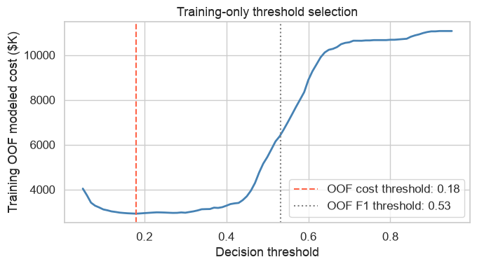

# Cost-Sensitive Insurance Fraud Detection

**A six-model comparison that connects fraud probabilities to the cost of investigation decisions.**

CMU Data Science & Big Data team project — **Heedong Jang and Mengzhang Yin (T08)**. This is a public adaptation of the course notebook, not a claim of sole authorship or an insurer deployment.

## What is implemented

- Exploratory analysis of 15,420 historical claims with a rare fraud label.
- Removal of `PolicyNumber`, `RepNumber` and `Year` as suspected leakage/proxy variables.
- Logistic Regression, Decision Tree, Random Forest, XGBoost, CatBoost and LightGBM comparisons.
- Training-based threshold selection, precision–recall curves and confusion matrices.
- An explicit decision cost: `15,000 × false negatives + 500 × false positives`.

The question is whether a different decision threshold is useful under stated costs, not whether the highest accuracy is automatically the best operational policy.

## Run

Use Python 3.12 from the repository root:

```bash
python3.12 -m venv .venv
source .venv/bin/activate
pip install -r requirements.txt
python -m pytest -q
```

Obtain an authorized copy of the course `carclaims.csv` dataset and place it in `data/`. See [data requirements](data/README.md). Alternatively set `FRAUD_DATA_PATH` to its absolute path. No customer records or dataset files are included.

Open [the analysis notebook](notebooks/fraud_analysis.ipynb) in VS Code or Jupyter using this environment, then run all cells. Install a Jupyter frontend separately if needed. The notebook supports opening from the repository root or `notebooks/` directory. A full run fits six models and performs cross-validation; it is not an instant demo.

For programmatic notebook execution:

```bash
python run_analysis.py
```

On macOS, XGBoost and LightGBM may require the OpenMP runtime (`brew install libomp`).

## Evaluation corrections in this public version

The course cost-analysis cell selected the cheapest threshold on test labels. This adaptation chooses it on **out-of-fold training predictions** and evaluates the fixed threshold on test data. Accordingly, old course cost/recall figures are not presented as the corrected run's results.

Other fixes: portable data paths, bounded parallelism, correct threshold-array indexing, and precision–recall markers at the actual training-selected operating point. Raw record previews and stored notebook outputs are omitted. The untouched course source remains in the author's private archive.

## Publication run (2026-11-08)

The complete notebook was executed on the local 15,420-row course input, with 3,084 rows in the test partition. This is a rerun of a previously explored benchmark, not a new external validation.

| Model | PR-AUC | ROC-AUC | Recall |
|---|---:|---:|---:|
| Logistic Regression | 0.171 | 0.801 | 0.595 |
| Decision Tree | 0.325 | 0.822 | 0.357 |
| Random Forest | 0.203 | 0.819 | 0.470 |
| XGBoost | 0.225 | 0.823 | 0.476 |
| CatBoost | 0.202 | 0.826 | 0.632 |
| LightGBM | 0.197 | 0.793 | 0.595 |

The corrected XGBoost cost threshold was **0.18**, selected from training OOF predictions. On the test partition, modeled cost was **$724,000**, versus **$1,657,500** at the OOF F1 threshold (about 0.533). These values depend on the $15,000 / $500 error-cost assumptions and are not realized business savings. PR-AUC here uses trapezoidal integration, not average precision.



[Aggregate metrics](results/model_comparison.csv) · [Assumed-cost comparison](results/cost_comparison.json)

## Limits

This is one historical benchmark. The dataset was already explored during coursework, so its test split is not a fresh external validation set. OOF thresholding follows training-set hyperparameter selection and is not fully nested CV. CatBoost uses an inner validation threshold followed by refitting. The retained course workflow learns categorical vocabulary before splitting; an operational version should fit preprocessing inside training folds. Age and sex appear in the original feature set, so fairness has not been established.

The class-weight diagnostic also changes tuning and thresholds and does not isolate the effect of weighting. Modeled costs depend on illustrative assumptions; no realized savings, causal effects or production accuracy are claimed.

[Portfolio case study](https://hdjang.com/projects/fraud/) · [Publication validation](VALIDATION.md)
